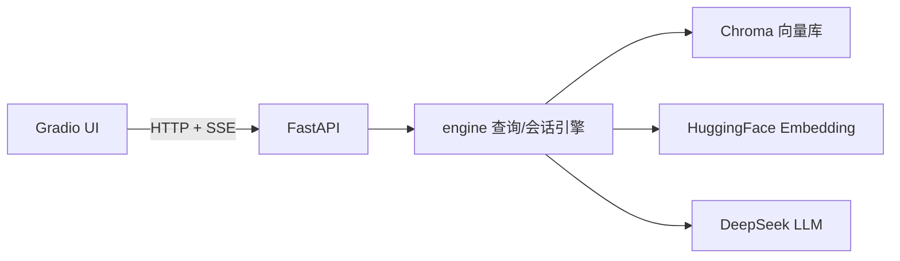

# HR 政策问答（RAG）

基于公司 HR 政策文档的检索增强问答系统：FastAPI 提供接口与 SSE 流式输出，Gradio 提供对话界面，支持中英文回答、多轮追问与可量化的离线评估。

## 功能

- **检索增强问答**：Chroma 向量库 + LlamaIndex，回答严格限定在检索到的政策片段内，无依据时明确拒答
- **流式输出**：`/chat` 基于 SSE 逐字返回，前端实时渲染
- **多轮对话**：追问自动改写为独立问题（Condense Question），会话记忆按 session 隔离
- **多语言回答**：默认中文回答，可切英文；中英文会话记忆互不影响
- **可观测**：每个请求写入 `logs/api_log.jsonl`，含改写后问题、命中片段（doc_id/score）、模型与提示词版本
- **可评估**：双评估集（标准问法 / 口语化真实问法）× 双指标（检索命中率 / 答案语义相似度）

## 架构



## 目录结构

```
RAG_HR/
├── run_local.py          # 一键启动 API + UI（统一回收子进程）
├── smoke_test.py         # 端到端冒烟测试（需先启动 API）
├── pytest.ini
├── requirements.txt      # 运行依赖
├── requirements-dev.txt  # 测试依赖
├── data/
│   ├── hr_dataset.json   # 原始 HR 政策问答数据
│   ├── docs/known_issues.md
│   └── eval/             # 评估集与评估结果
├── src/
│   ├── config.py         # 路径/模型/检索参数
│   ├── ingest.py         # 构建 Chroma 索引
│   ├── engine.py         # 索引、提示词、查询与会话引擎
│   ├── api.py            # FastAPI：/query /chat /reset /health
│   ├── ui.py             # Gradio 界面
│   ├── evaluate.py       # 离线评估
│   └── chat.py           # 旧版命令行问答（保留参考）
├── tests/                # pytest 单元测试（engine 打桩，秒级完成）
└── scripts/build_eval_set.py
```

## 快速开始

### 1. 安装依赖

```powershell
python -m venv .venv
.\.venv\Scripts\Activate.ps1
pip install -r requirements.txt
```

### 2. 配置 API Key

在项目根目录创建 `.env`（已被 `.gitignore` 忽略）：

```
API_KEY=sk-你的DeepSeek密钥
```

模型与服务地址在 `src/config.py` 中配置（`LLM_MODEL`、`LLM_BASE_URL`、`EMBED_MODEL`、`SIMILARITY_TOP_K`）。

### 3. 构建索引

首次运行或数据更新后执行（需联网下载 embedding 模型，已配置 hf-mirror 镜像）：

```powershell
cd src
python ingest.py
cd ..
```

索引写入 `chroma_db/`，集合名为 `hr_policies`。

### 4. 启动服务

推荐一键启动（自动检查端口、等待 API 就绪、Ctrl+C 一并关闭）：

```powershell
python run_local.py
# 端口被上次残留进程占用时：
python run_local.py --kill
```

启动后访问 `http://127.0.0.1:7860`。

手动启动（两个终端）也可以：

```powershell
python -m uvicorn api:app --app-dir src --host 127.0.0.1 --port 8000
python src\ui.py
```

> `src` 下的模块使用 `from config import ...` 这种以 `src` 为根目录的导入，因此必须带 `--app-dir src`（或先 `cd src`），否则会报 `ModuleNotFoundError: No module named 'config'`。

## API

| 方法 | 路径 | 说明 |
|---|---|---|
| POST | `/query` | 单轮问答，一次返回完整答案 |
| POST | `/chat` | 多轮流式问答，SSE |
| POST | `/reset` | 释放指定会话（中英文会话一起清理） |
| GET | `/health` | 健康检查，返回活跃会话数 |

### POST /query

```powershell
Invoke-RestMethod -Uri http://127.0.0.1:8000/query -Method Post `
  -ContentType "application/json" `
  -Body '{"question":"What are the official working hours?","lang":"zh"}'
```

```json
{
  "answer": "NovaTech Solutions 的标准工作时间为周一至周五 9:30 AM 至 6:30 PM……",
  "sources": [{"doc_id": 0, "score": 0.62, "text": "Question: What are the official working hours..."}]
}
```

### POST /chat（SSE）

请求体：`{"message": "...", "session_id": "可选", "lang": "zh|en"}`。事件顺序：

```
data: {"session_id": "e186c307..."}          # 首次请求由服务端生成，后续追问需回传
data: {"status": "condensing"}               # 正在改写追问
data: {"delta": "NovaTech"}                  # 逐 token
data: {"sources": [...], "done": true}       # 收尾：命中片段 + 结束标志
```

### GET /health

```json
{"status": "ok", "sessions": 2}
```

## 界面说明

- **回答语言**：侧边栏切换，默认中文；影响回答语言与示例问题
- **示例问题**：点击填入输入框（不自动发送），中文示例保留英文关键词以适配英文向量索引
- **参考片段**：折叠面板展示 Top-3 片段与相似度，便于核对答案依据
- **新会话**：清空界面并通知后端 `/reset`，释放会话记忆

## 评估

```powershell
cd src
python evaluate.py          # 标准问法评估集 data/eval/eval_set.jsonl
python evaluate.py real     # 口语化真实问法 data/eval/eval_real.jsonl
```

指标定义：

- **检索命中率**：`ground_truth` 前 80 字是否出现在任一检索片段中
- **答案语义相似度**：答案与 `ground_truth` 的向量余弦相似度
- **答案通过率**：相似度 ≥ 0.8 视为通过

结果分别写入 `data/eval/results_baseline.json` 与 `results_real.json`。

## 日志

`logs/api_log.jsonl` 每行一条 JSON 记录：

| 字段 | 说明 |
|---|---|
| `endpoint` / `session_id` | 请求来源与所属会话 |
| `question` / `rewritten_question` | 原始问题 / 追问改写后的独立问题 |
| `lang` | 回答语言 |
| `answer` | 完整回答 |
| `sources` | 命中片段：`doc_id`、`score`、原文摘要 |
| `latency_ms` / `num_sources` / `status` | 性能与结果状态 |
| `model` / `prompt_version` | 模型名与提示词版本，便于横向对比 |

badcase 快速统计：

```python
import json
import pandas as pd

rows = [json.loads(l) for l in open("logs/api_log.jsonl", encoding="utf-8")]
df = pd.DataFrame(rows)
df["refused"] = df["answer"].str.contains("无法回答|cannot answer", na=False)
print(df.groupby(["lang", "refused"]).size())
```

## 测试

```powershell
pip install -r requirements-dev.txt
python -m pytest          # 单元测试：engine 打桩，不加载模型、不写真实日志
python smoke_test.py      # 端到端冒烟：需先启动 API，会真实调用大模型
```

单元测试覆盖：健康检查、`/query` 返回结构、`/chat` SSE 事件序列、`/reset` 多语言会话清理、日志字段完整性、配置与数据文件存在性。

## 常见问题

| 现象 | 原因与处理 |
|---|---|
| `[Errno 10048] error while attempting to bind on address ('127.0.0.1', 8000)` | 端口被上次进程占用：`netstat -ano \| findstr :8000` 查 PID 后 `taskkill /PID <PID> /T /F`，或直接用 `python run_local.py --kill` |
| `ModuleNotFoundError: No module named 'config'` | 在项目根直接 `uvicorn src.api:app`：改用 `--app-dir src` 或先 `cd src` |
| `OpenAIError: The api_key client option must be set` | 未配置 `.env` 的 `API_KEY` |
| `Collection [hr_policies] does not exist` | 尚未建索引：`cd src && python ingest.py` |
| 直接运行 `src/api.py` 进程秒退 | `api.py` 只有在 `__main__` 分支里才启动 uvicorn；确认已加该分支 |
| 中文提问多被拒答 | 向量模型为英文（`bge-small-en-v1.5`），建议英文提问；根治需换多语言 embedding（如 `BAAI/bge-m3`）并重建索引 |
| Gradio 启动报 `unexpected keyword argument 'theme'` | Gradio 6 中 `theme`/`css` 只能写在 `demo.launch()`，不能写在 `gr.Blocks()` |

## 已知限制

- 会话记忆存在进程内存中，进程重启即丢失，且多 worker 部署不共享
- 中文查询召回率受英文 embedding 限制
- 检索为单路向量检索，未启用阈值拒答与 rerank

